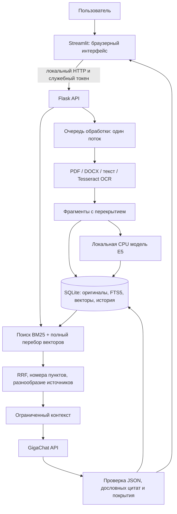

# Критический аудит архитектуры и работоспособности

Дата: 14 октября 2026. Объект: локальный проект Flask + Streamlit + GigaChat, рабочая папка `/Users/andrey/Desktop/document-rag-vscode`. Проверка кода, регрессионные тесты, повторное испытание поиска по отдельной базе из 50 файлов. Пользовательские документы, ключи и база не использовались для испытаний.

## Вывод

**Система годится как локальный помощник для поиска и ответов с цитатами под контролем человека. Она пока не является системой проверки соответствия ГОСТ, полной сверки документов или корпоративным сервисом на 100 пользователей.**

У прототипа есть настоящие извлечение текста, OCR, локальные эмбеддинги, гибридный поиск, API, интерфейс, сохранение документов и диалогов. Это не макет. Но наличие рабочего конвейера и успешных тестов поиска не доказывает надёжность ответов модели. Ошибка может появиться на любом этапе: распознавание → разбивка → выбор источников → интерпретация → генерация.

## Как устроена система



Это гибридный RAG по фрагментам с переформулированием вопроса по истории. Не GraphRAG, не полный обход требований и не доказательная экспертная система. Flask отвечает за данные и вычисления; отдельного HTML-интерфейса у него нет. Streamlit — единственный пользовательский интерфейс. Внешний GigaChat получает вопрос, отобранные фрагменты и, при уточнении вопроса, ограниченную историю. E5 и OCR работают локально.

## Что исправлено в этом обновлении

1. Перенесены ранее испытанные улучшения: поиск точных пунктов и кодов мер, нормализация OCR-похожих символов только для поиска, расширение найденного пункта соседними фрагментами той же страницы, распределение результатов между документами.
2. В ответе и интерфейсе показано, из скольких выбранных документов действительно попали фрагменты. Выбор 50 файлов больше не выглядит как доказательство проверки всех 50.
3. Устранено удержание общей блокировки во время запросов к GigaChat. Поиск, загрузка и удаление могут выполняться во время ожидания модели. Генерация ответов по-прежнему последовательна: это сознательное ограничение локального пилота.
4. Добавлена проверка снимка источников до поиска и перед сохранением ответа. Если выбранные документы изменены/удалены либо удалён диалог, устаревший ответ не сохраняется; API возвращает HTTP 409. Это защита внутри одного процесса, а не распределённая транзакция.
5. Источники новых ответов сохраняют SHA-256 редакции документа. Добавлены отдельные признаки проверки цитат и отсутствия семантической проверки. Ограничение видно непосредственно возле ответа.
6. Пакетная загрузка продолжает работу после ошибочного файла, показывает ошибки по именам и выбирает успешно загруженные документы.
7. Уточнён промпт: разные области применения, смена редакции, совместимые максимальные сроки и неясная периодичность не должны автоматически называться противоречиями. Это инструкция модели, не доказанный классификатор.
8. Предупреждение о таблицах/формулах PDF и воспроизводимые материалы испытания добавлены в рабочий проект. Ваш сокращённый README сохранён с дополнительными ссылками; полная инструкция вынесена в `SETUP_AND_USAGE.md`.

## Существенные проблемы, которые остаются

Приоритет P0 здесь означает блокирующее ограничение для доверенного автоматического аудита или корпоративного внедрения, а не найденную удалённую уязвимость локального приложения.

| Приоритет | Наблюдение и доказательство | Последствие / нужное изменение |
|---|---|---|
| P0 | `answering.py:4` проверяет, что цитата встречается в источнике, но не следует ли из неё утверждение. Тест `test_real_quote_does_not_prove_claim` принимает «999 дней» с настоящей цитатой «10 рабочих дней». | Ложный вывод может получить статус `answered`. Нужны извлечение структурированных фактов, проверка чисел/условий, независимая оценка смыслового соответствия и ручная проверка существенных выводов. Дополнительная LLM-проверка также не даёт гарантии. |
| P0 | `engine.py:214`: обычный запрос берёт top-k, сравнение — до 3 фрагментов из каждого из 2–8 документов. `full_document_review` всегда false. | Запрос «найди все нарушения во всех 50» не выполняет такую проверку. Нужен отдельный проход по реестру требований с результатом по каждому пункту и явными пробелами покрытия. |
| P0 | В схеме БД нет пользователей, организаций, прав доступа и аудита действий; токен общий. Flask запускается локальным development server (`api.py:170`). | Нельзя выдавать этот проект за готовый многопользовательский сервис. До корпоративного размещения нужны аутентификация, ACL на документ/индекс, изоляция, управляемые секреты, журналирование, ограничения нагрузки и соответствующее развёртывание. |
| P1 | `extraction.py:71`: OCR включается по длине текстового слоя, а не его качеству. Таблицы PDF/DOCX превращаются в последовательность текста; DOCX-рисунки и сноски не обрабатываются. | Потеря связи «мера — уровень защиты», неверные числа или отрицания. Для ГОСТ нужны структура таблиц, связь с координатами страницы, показатели качества OCR и визуальная сверка критичных мест. |
| P1 | `retrieval.py` повышает рейтинг совпадающего номера пункта, не разрешая формально его принадлежность конкретному стандарту/редакции. | Одинаковый пункт 6.13 в разных документах может конкурировать неправильно. Нужны метаданные стандарта/версии и адрес пункта вида `(документ, редакция, раздел, мера)`. Пока следует явно выбирать нужный документ. |
| P1 | `engine.py:136`: векторы читаются как JSON, вычисляется Python dot product для всех фрагментов выбранных файлов, список полностью сортируется. | Стоимость растёт с числом фрагментов и размерностью; «50 документов» без их объёма не является нагрузочной характеристикой. Нужны измерения на реальном объёме, затем матричное/индексированное хранение и векторный индекс с фильтрами доступа. |
| P1 | `api.py:19`: один поток индексации, задания в памяти. `ui.py:112`: длительный синхронный опрос, без отмены и восстановления задания после рестарта. | Очередь теряется при сбое; пользователь плохо понимает прогресс больших сканов. Нужны сохраняемые состояния заданий, прогресс по страницам, отмена и идемпотентность запросов. |
| P1 | `engine.py:82`: ID зависит от имени файла, повторное имя заменяет оригинал; старые ответы сохраняют текстовые снимки, но старый оригинал отдельно не хранится. | Два разных «Положение.pdf» могут перезаписать друг друга. Для доказательной проверки нужны отдельный ID документа, история редакций и явное подтверждение замены. Текущая семантика сохранена ради совместимости базы. |
| P1 | Есть лимиты 25 MiB/200 страниц и тайм-ауты дочерних OCR-процессов, но нет общего лимита распакованного текста, пикселей, CPU/RAM и дискового объёма базы. | Тяжёлый или повреждённый файл способен надолго занять процесс либо исчерпать ресурсы. Нужны изолированные workers с ресурсными лимитами; текущая обработка не является песочницей для недоверенных файлов. |
| P1 | Бюджет контекста измеряется в символах сериализованных источников, не в токенах полной системной инструкции. Разбиение по символам может разорвать условие или превысить лимит токенизатора E5. | Возможны пропуски нужного условия и отказ индексации некоторых файлов. Нужны разбивка по структуре/токенам и полный бюджет запроса, включая ответ. |
| P1 | Указание «источники — данные» находится в промпте; в корпусе есть prompt injection, но измерено только нахождение источника. | Устойчивость генерации к инструкциям из документов не доказана. Нужны отдельные атаки и проверка ответов; недоверенному тексту нельзя давать инструменты или полномочия. |
| P2 | `/health` сообщает настройки и живость API, а не работоспособность OCR/E5/GigaChat. `doctor --live` проверяет OAuth и список моделей, не генерацию. | Зелёный статус не означает готовый ответ. Разделить liveness/readiness и явную контрольную генерацию с известным результатом. |
| P2 | Отсутствие запрещённых пакетов проверяется по именам установленных дистрибутивов; нет полного транзитивного lock с хешами, SBOM и проверки лицензий/уязвимостей. | Требование «нет openai» проверяется, но это не полноценный аудит цепочки поставок. Текущие результаты не распространяются на произвольную будущую переустановку зависимостей. |
| P2 | SQLite содержит оригиналы, распознанный текст, векторы и переписку без прикладного шифрования; резервные копии и удаление требуют отдельной политики. | Перезапуск сохраняет данные. Удаление из интерфейса удаляет связанные записи и диалоги, но не внешние копии и не даёт гарантии физического стирания следов. Нужны права файловой системы, защищённое хранилище и политика хранения. |

Существующие транзакции защищают замену от частичного повреждения; неудачная загрузка не стирает предыдущий документ. Однако два отдельных сервера с одной базой не поддерживаются: блокировки и очередь находятся в памяти одного процесса. История читается целиком для диалога; для длинной эксплуатации нужны пагинация и ограничение объёма.

## Что проверено практически

- **44 автотеста прошли.** Ядро, Flask, OAuth/обновление токена с подставными ответами, Streamlit AppTest, поиск/история/удаление/backup, новые конкурентные сценарии и пакет «ошибочный файл, затем исправный».
- До исправления новые конкурентные тесты воспроизвели ожидание поиска/замены/удаления из-за общей блокировки. После исправления операции выполняются, а изменившийся снимок отклоняется.
- Повторно проверен существующий отдельный индекс: **50 документов, 1254 фрагмента; 24/24 запросов с известными источниками нашли все ожидаемые документы; 6/6 вопросов по ГОСТ нашли контрольные текстовые фрагменты**. SHA-256 файлов и редакций индекса проверены. Это повторный поиск, не повторная полная OCR-индексация.
- После добавления хеша редакции повторно проверена упаковка контекста с подставным провайдером: все ожидаемые источники сохранились в 24/24 проверяемых запросов. Это не тест качества генерации.
- В этом повторе медиана поиска около 0,075 с, первый холодный запрос около 3,23 с. Результат зависит от компьютера, размера и характера корпуса; не SLA для пользователей. Замеры не включают ответ GigaChat.
- Предыдущая полная индексация и настоящий OCR 8 сканированных PDF описаны отдельно в `evaluation/REPORT.md`. Сканы искусственные и сравнительно лёгкие, PDF в наборе повторяют шаблоны. Это не репрезентативный архив финансовой организации.
- **В этом аудите живые запросы генерации GigaChat не выполнялись.** Из предыдущих скриншотов пользователя видно успешное сравнение двух текстов, но этого мало для оценки надёжности на стандартах. Здесь не проверены тариф, квота, доступность модели, качество ответа на ГОСТ и устойчивость генерации к prompt injection.
- После изменений проверены Streamlit AppTest и Flask test client. Повторный визуальный проход через браузер и нажатие F5 в VS Code в этом аудите не проводились. Нагрузочный тест 100 пользователей, penetration test и независимая юридическая/нормативная экспертиза не проводились.

Файлы результатов: `evaluation/results/audit-tests.txt`, `audit-retrieval.json`, `audit-context.json`. 100% на 24 известных поисковых вопросах — узкая метрика покрытия источников, **не 100% точность системы**. Часть настроек подбиралась по этому же набору, поэтому нужна новая независимая выборка. Отрицательный вопрос без ответа не имеет оценки полноты источников; способность модели отказаться от ответа здесь не измерена.

## Что необходимо именно для проверки ГОСТ

В текущем коде нет реестра требований 57580.1, применения методики 57580.2, расчёта итоговых показателей, решения о применимости, матрицы «требование — свидетельство — результат» и полного контроля редакций. Не следует выводить соответствие организации только из загруженных двух стандартов: стандарты задают требования/методику, а подтверждение выполнения требует документов и фактов организации. Это описание отсутствующих функций, не заключение о соответствии конкретной организации.

Следующая функциональная итерация должна:

1. Представить каждый пункт/меру отдельной записью с редакцией, точной ссылкой, областью применения и таблицей/страницей оригинала.
2. По каждому требованию искать свидетельства, а не задавать один общий вопрос всему архиву; сохранять состояния «подтверждение найдено», «возможное несоответствие», «противоречие», «недостаточно данных», «нужна ручная проверка».
3. Извлекать факты со структурой: объект, действие, модальность, значение/единица, минимальный/максимальный/точный срок, период действия, область применения и источник. Сопоставлять совместимость в одном контексте. Различия чисел сами по себе не означают противоречие.
4. Отдельно вести пересечения/дубли, отменённые редакции и неоднозначности. Не смешивать «24 часа против 1 часа как верхние границы» с «ровно 90 против ровно 365 дней».
5. Сделать независимую контрольную выборку, которую не используют для настройки поиска: реальные таблицы, плохие сканы, совпадающие номера пунктов, смена редакций, отрицания и вопросы без ответа. Оценивать отдельно recall источников, правильность фактов, точность цитирования, ложные противоречия, пропуски и корректные отказы.
6. Проверить живую генерацию GigaChat на этой выборке с ручной разметкой, а затем уже выбирать изменения модели и поиска. Добавление сложного RAG-фреймворка само по себе эти проблемы не решит.

## Оценка принятых решений

Для первого локального пилота удачны простая структура, отсутствие тяжёлого серверного стека, локальные OCR/E5, транзакционная SQLite, оригиналы рядом с индексом, явная область поиска, запрет несуществующих цитат, проверяемый транспорт GigaChat и тесты интерфейса. TLS не отключён, редиректы провайдера запрещены, ключ не передаётся в аргументах процессов; OpenAI SDK не нужен.

Слабое место — попытка возложить нормативное сравнение на один генеративный ответ по нескольким коротким фрагментам. Именно здесь находится главный предел качества, а не в выборе Flask вместо другого веб-фреймворка. Переход на корпоративное размещение также потребует изменения хранения, фоновых задач и модели доступа, а не только упаковки текущего процесса в Kubernetes.

## Повторение локальных тестов

Из корня проекта после установки окружения:

```bash
.venv/bin/python -m unittest discover -s tests -v
.venv/bin/python manage.py doctor
```

Команды работы с искусственным корпусом находятся в `evaluation/README.md`. Используйте отдельную базу испытаний; не заменяйте ею пользовательскую библиотеку. Для применения обновления остановите прежний `manage.py run`, затем запустите его заново. Настройки, ключи, модель и рабочая база этим обновлением не меняются. Старые ответы сохраняют свой прежний формат; новые содержат хеш редакции и признаки проверки.
