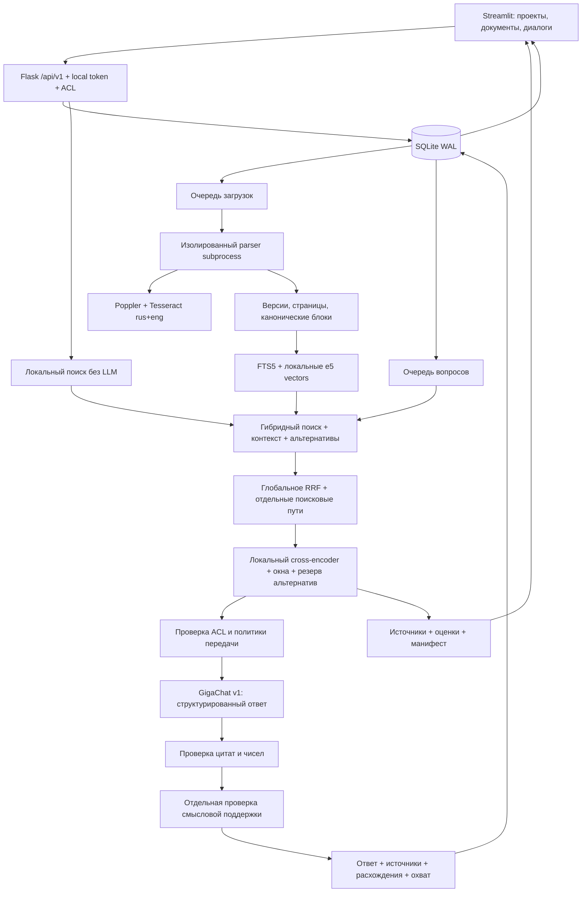

# Архитектура SQLite MVP

Актуально на 15.10.2026, версия 0.3. Пользователь подтвердил SQLite как основу
локального MVP. Перенос в PostgreSQL/Redis/S3 исключён из текущего этапа.
Существующий legacy-контур сохранён отдельно; его база не меняется.

## Границы модулей

| Модуль | Ответственность |
|---|---|
| store.py / schema.sql | Транзакции, доступ, версии, канонические блоки, индексы, резервная копия |
| ingest.py / extract_task.py | PDF/изображения, постраничные ошибки, структура, отдельный ограниченный процесс |
| embeddings.py | Заменяемый локальный EmbeddingProvider, e5-small фиксированной ревизии |
| retrieval.py | Lexical/semantic/numeric, родитель/сосед/cross-reference, альтернативы, бюджет и манифест |
| reranking.py | RerankerProvider, pinned safetensors, token windows, exact spans, CPU inference lock |
| jobs.py | Идемпотентная очередь вопросов, контекст диалогов, восстановление |
| generation.py | JSON Schema, многоэтапный анализ, числовой валидатор, проверка утверждений |
| answering.py | Политика передачи, snapshot корпуса, предупреждения, аудит вызовов и сохранение ответа |
| runtime.py | Серверная конфигурация GigaChat и обязательного локального реранкера, env override |
| api.py / contract.py | Аутентификация, API, OpenAPI, запуск трёх рабочих потоков |
| reports.py / bank_ui.py | Безопасный печатный отчёт и пользовательские сценарии |

## Хранение и миграция

SQLite `data/bank/audit.sqlite3`, WAL, foreign_keys, транзакции и busy timeout.
Аддитивная схема v1→v2→v3 применяется при открытии Store, не удаляет существующие
таблицы/оригиналы/историю. v3 добавляет conversations, question_jobs,
maintenance_jobs, llm_calls, settings. Все payload/text параметры SQL связаны
через placeholders. Реальные секреты остаются вне БД в secrets/ или env.

Оригинал сохраняется по SHA-256; версия имеет собственный ID и parser_version.
DocumentBlock имеет ID, page_index/page_number, section_path, parent_block_id,
точный текст, normalized text, метод, quality flags, content_hash.
Печатная пагинация/координаты не выдумываются. Все физические страницы/кадры
учтены, включая непрочитанные. Источники ответа привязаны к версии.

Повтор распознавания и ручная коррекция страницы создают новую версию;
оригинальные байты и старые цитаты не меняются. Vectors — производный индекс,
его можно перестроить по каноническим блокам без повторного OCR.
При переходе в hybrid существующие lexical-only документы ставятся в очередь.
Резервная копия использует SQLite backup API, а не копирование открытого WAL-файла.

## Фоновые задачи и отказоустойчивость

Один backend-процесс владеет flock базы. В нём три независимых потока:
загрузка/OCR, переиндексация, вопросы. Их очереди сохраняются в SQLite;
несколько пользователей/процессов не должны запускать один и тот же worker.
На рестарте running возвращаются в queued; число восстановлений ingestion/questions
ограничено. Уже сохранённый answer завершает job без повторного вызова GigaChat.

POST questions возвращает 202 и ID. UI опрашивает статус каждые 2 секунды,
перезагрузка страницы не отменяет вопрос. Idempotency-Key предотвращает
повторное создание задания. До пяти незавершённых вопросов на пользователя/проект.
Ошибка потока не убивает worker; health показывает его состояние/счётчик ошибок.

PDF parsing выполняется в дочернем процессе: общий wall timeout 900 секунд,
CPU 300 секунд, лимит файлов/выхода, на Linux также address-space limit 2 GiB.
OCR/растрирование ограничены отдельно. Это изоляция от зависаний, не полноценная
песочница для вредоносных файлов. При остановке parser уничтожается его группа.

## Ответ и проверки

История последних трёх вопросов используется только в выбранном диалоге того же
пользователя/проекта. Retrieval выполняется заново. Источники истории также
перепроверяются по ACL и external policy перед внешней передачей.

До каждого запроса GigaChat, включая retry и verifier, проверяются доступ,
политика документов и неизменность index_version. Изменившийся корпус требует
нового вопроса. Сырой prompt в llm_calls не сохраняется: только stage, model,
IDs блоков, статус, usage и hash шаблона. Неуспешные попытки тоже записываются.

Модель возвращает claims/evidence/assessments/limitations по JSON Schema.
Backend проверяет ID, подстроки цитат и числовые значения. Отдельный вызов
проверяет, подтверждается ли смысл утверждения цитатами; отвергнутые утверждения
не публикуются. Это дополнительная проверка LLM, не математическое доказательство.
Серверные потенциальные расхождения сохраняются независимо от указаний документа.
Объяснение изменения требует трёх источников, явного изменения, даты и as_of;
неподтверждённый/будущий приоритет понижается до needs_review.

Контекст разбивается на группы примерно до 14000 символов; 422 дополнительно
делит группу с сохранением ID. Общий бюджет до 12 обращений и 180 секунд
плюс текущий сетевой timeout. При неполноте сохраняются явные ограничения.
Длинный исходный блок берётся точной подстрокой, а не пропускается целиком.

## Честные ограничения

SQLite vector search пока линейный; это не обещание SLA на 5000 страниц.
Полный layout-aware разбор таблиц/сносок и междокументный resolver не завершены.
Claims-index опционален и отключён. Реранкер включён по умолчанию. Coverage остаётся partial:
поиск по доступным индексам не равен доказанной полноте чтения.
Корпоративные OIDC, шифрование хранения, AV и банковская приёмка — вне этого
согласованного локального MVP. Автоматическое юридическое заключение не выдаётся.

## Ранжирование и standalone поиск (v0.3)

POST `/projects/{project}/search` использует тот же Retriever, что ответы.
Поддерживаются query, top_k 1–50 и document_ids; фильтрация ACL/scope выполняется
до e5/FTS/cross-encoder. После inference повторно проверяются доступ и версия
корпуса. Локальный запрос не вызывает GigaChat и не требует external_allowed.

Лексические BM25 и семантические cosine позиции объединяются глобальным RRF
(k=60), числовые точные совпадения получают отдельный бонус. Нельзя сравнивать
rank=1 внутри разных документов как одинаковую релевантность. Отдельные пути
semantic/lexical/numeric/alternatives/exceptions/amendments/cross_reference и
представительство документов формируют ограниченный пул до 160 блоков.

RerankerProvider.score возвращает RankScore: logit, точный символьный span
лучшего окна, число обработанных/всех окон и факт усечения вопроса. Реализация
LocalCrossEncoder: mmarco-mMiniLMv2-L12-H384-v1@1427fd652930e4ba29e8149678df786c240d8825.
Question ≤96 tokens; пара ≤384; перекрытие окон 64; до 12 равномерно выбранных
окон, включая последнее. Все окна оцениваются batch=8 под inference lock.
Максимум по окнам определяет релевантность блока. В контекст попадает точная
подстрока около лучшего окна, canonical ID и привязка страницы не меняются.

После rerank резервируются лучшие результаты, исключения/изменения/числа,
альтернативы из других документов (до 24) и доступные соседи/родители. После
упаковки в бюджет выбранные результаты отображаются по релевантности.
Ограничения кандидатов/окон/вопроса/контекста и пропущенные связанные блоки
отражаются в coverage_manifest. Score не является confidence ответа. Низкая
оценка сама по себе не доказывает отсутствие нормы.

Ошибка/NaN/неверная длина результата → явный fallback к RRF. Отсутствующие или
повреждённые веса при BANK_RERANKER_MODE=required блокируют старт. Веб-интерфейс
и /health показывают режим; ответы сохраняют модель, фактический статус,
число кандидатов/окон, оценки и длительность ранжирования.
